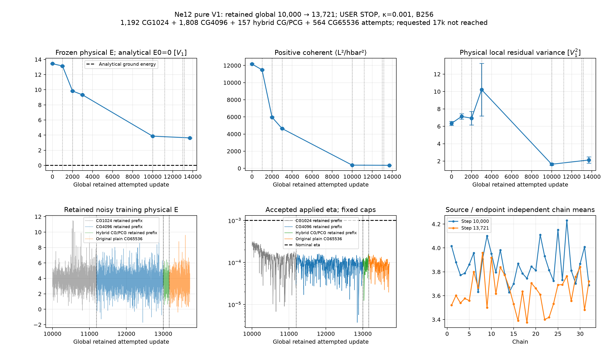

# Historical Ne12 stopped result

The calculation was stopped and stored at global attempted update 13,721.
The latest requested segment retained 3,721 of 7,000 attempts; the remaining
3,279 were not run. It uses 34 LLL orbitals, flux 33, fixed Lz=0, pure V1,
no wall, kappa=0.001, batch 256 and a 1,024-row sampling pool. Its angular-head
model/objective differs from the portable baseline.

The [archived objective and SPRING solve](ARCHIVED_REPORT.md#same-physical-loss-and-spring-linear-equation) are

```math
\begin{aligned}
J &= E_H+A_{\rm heads}+0.001\langle L^2/\hbar^2\rangle,\\[0pt]
(G_{\rm aug}+\lambda I)\phi &=
\tfrac12\nabla\widehat J+\lambda\mu\phi_{\rm prev},
\qquad \lambda=0.1,\quad \mu=0.9.
\end{aligned}
```

Independent frozen Born-MC evaluation gives physical energy
**3.6344834 +/- 0.02660 V1**, compared with analytical E0=0. There is no Ne12
ED fidelity. The variance is 2.1301881 +/- 0.36019 V1²; coherent
`<L²/hbar²>=348.98054 +/- 6.84596`. Error bars are the original protocol's
independent-chain MCSE, not a guarantee against unseen tails. This state has
not converged to Laughlin.



Read the byte-preserved [original report](ARCHIVED_REPORT.md) for solver
failures, discarded/replayed attempts, guard rejection, effective steps,
sampling diagnostics and costs. The final leg uses plain CG with raised
iteration ceiling; a rejected GMRES proposal was never used for training.
See [frozen research source](../../training/research_snapshot/README.md).

The final full-state checkpoint remains local, SHA256
`54458312dae2fa4841c4053397b677018a09cd3e403fce54111ea7407c672a18`.
`PROVENANCE.json` hashes these copied reports/figures. The original
`storage_manifest.json` binds the full original study, whose raw inputs are
not all shipped. It is not the Git payload manifest. Nothing here launches a
continuation, and the new portable checkpoint schema cannot resume this model.
