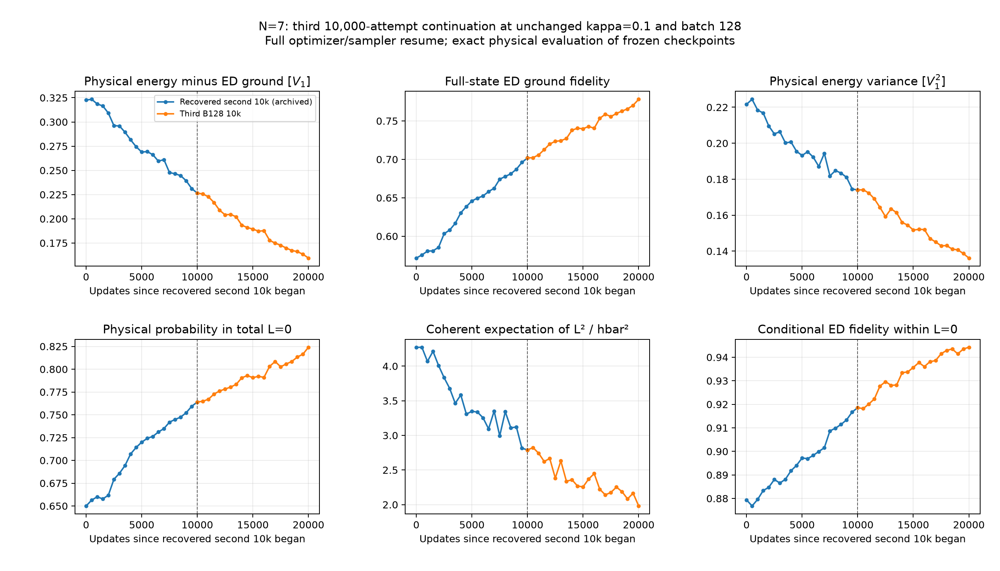

# Historical Ne7 angular-aware result

This is selected evidence from the original no-wall study, not training with
the new portable baseline. The physical Hamiltonian is
`H/V1=sum(P1)+0.8*sum(P3)+0.6*sum(P5)` at flux 18, Lz=0 in the LLL.
The sampled objective additionally includes the angular-head auxiliary and
`0.1*<L²/hbar²>`. No exact total-L projection or ED target enters training.

The final retained segment continues global attempted update 44,000 to 54,000
with B=128, pool=512, nominal eta=0.001 and inherited SPRING memory/RNGs.
Of its 10,000 attempts, 9,925 were accepted. Frozen full-sector evaluation gives:

| Quantity | Source | Endpoint |
|---|---:|---:|
| Physical energy / V1 | 6.47130742 | 6.40426894 |
| Error above matching ED | 0.22653916 | 0.15950068 |
| Full ground-state fidelity | 0.70183316 | 0.77816879 |
| P(L=0) | 0.76405088 | 0.82410610 |
| Physical variance / V1² | 0.17400494 | 0.13617091 |

Matching ED ground energy is 6.244768260215 V1. These are complete-sector
frozen measurements, not the noisy training-row energy. Independent NumPy/SciPy
evaluation reproduces the saved metrics within 3.22e-14. Conditional L=0
fidelity is 0.94425802; it must not replace the full fidelity above.

This Hamiltonian differs from the portable pure-V1 baseline and the later Ne12
pure-V1 study. Their energies cannot be used as a matched optimizer comparison.
The endpoint is still above its ground energy. `PROVENANCE.json` hashes each
copied artifact. Checkpoints and the original full inputs remain local; the
copied validation reports describe their original validation scope, not a new
revalidation of absent raw inputs. No new inference or training produced this
copy. The shared benchmark database's 11-instance count describes its frozen
pure-V1/Ising dataset; the extra ED numbers here belong to this separate study.
