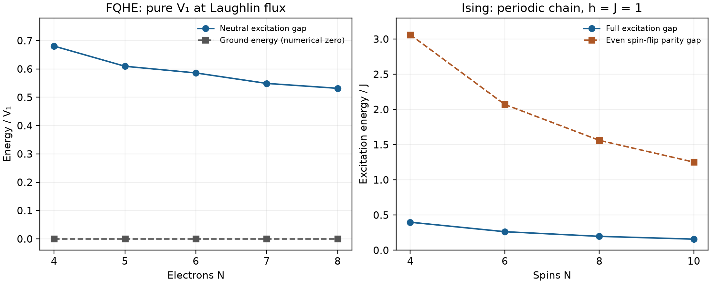

# Exact-diagonalization benchmarks

These are executed small-system references for the implemented Hamiltonians. ED uses complete finite Hilbert sectors, with numerical eigenpair checks; there is no Monte Carlo sampling or new neural training in this benchmark.



## FQHE: Haldane sphere in the LLL

The calculation retains the fully spin-polarized lowest Landau level, flux Nphi=3(N−1), fixed M=Lz=0, and H/V1=sum P_R=1 with normalized pair projectors. The canonical Slater basis includes fermionic antisymmetry. All energies below are total energies in V1 units, without an energy shift.

| N | Orbitals | Full fixed-N dimension | M=0 dimension | ED E0/V1 | Neutral gap/V1 | First excited L |
|---:|---:|---:|---:|---:|---:|---:|
| 4 | 10 | 210 | 18 | 2.48e-17 | 0.6806042469 | 4 |
| 5 | 13 | 1,287 | 73 | -7.90e-17 | 0.6093170812 | 4 |
| 6 | 16 | 8,008 | 338 | -2.97e-17 | 0.5857799673 | 5 |
| 7 | 19 | 50,388 | 1,656 | 2.36e-17 | 0.5487487546 | 5 |
| 8 | 22 | 319,770 | 8,512 | -1.66e-16 | 0.5315767947 | 5 |

Every ground state is the unique zero mode to numerical accuracy, has L=0, and has uniform one-body density. The small negative or positive E0 values are floating-point roundoff. The positive neutral gap is E1−E0 at fixed N and flux; it does not indicate a nonzero ground energy. Since all total L are integer here, M=0 contains a representative of every rotational multiplet. This is not a quasiparticle/charge gap or an L=0-only gap.

The code freshly solves each Hamiltonian. It retains 20 low eigenpairs (all 18 for N=4), checks degenerate-energy cutoffs, and verifies each reported L using full-space H and L² residuals. Existing N=6–8 reference files were not overwritten. Independent highest-weight ladder and fermion annihilation constructions validate the R=1 Hamiltonian for N=2–4.

[FQHE numerical tables, low eigenvectors and diagnostics](../SPRING_Haldane_FQHE/results/ed_benchmarks/README.md)

## Ising: periodic transverse-field chain

The Hamiltonian is H=−J sum Z_i Z_(i+1)−h sum X_i, with Pauli eigenvalues ±1 and periodic boundaries. Site i is bit i of the basis integer; bit 0 has Z_i=−1. ED diagonalizes both spin-flip parity blocks and merges their complete spectra. All energies below use J=1.

| N | h/J | Dimension | ED E0/J | Full gap/J | Even-parity gap/J |
|---:|---:|---:|---:|---:|---:|
| 4 | 1 | 16 | -5.226251859506 | 0.3978247348 | 3.0614674589 |
| 6 | 0.5 | 64 | -6.384694563604 | 0.0068924450 | 2.4786273499 |
| 6 | 1 | 64 | -7.727406610313 | 0.2633049952 | 2.0705523608 |
| 6 | 2 | 64 | -12.769389127207 | 2.0137848899 | 4.9572546997 |
| 8 | 1 | 256 | -10.251661790966 | 0.1969828067 | 1.5607225761 |
| 10 | 1 | 1,024 | -12.784906442999 | 0.1574034136 | 1.2514757203 |

The full gap includes the opposite-parity excitation. The current bias-free RBM has even spin-flip parity, so its symmetry-sector fidelity bound can use the larger even-parity gap. At h=J=1, the ED results also match the independent finite-ring expressions E0=−2 csc[π/(2N)], full gap=2 tan[π/(4N)], and even gap=8 sin[π/(2N)].

[Ising spectra, observables and saved states](../SPRING_Ising_test/benchmarks/ed/README.md)

## Existing neural states compared with ED

These are comparisons of retained checkpoints with the appropriate exact ground state. They are different physical problems and different ansatzes, not a controlled speed comparison between algorithms. Variances use the square of the corresponding energy unit.

| Retained state | ED E0 | Neural energy | Energy error | Ground-state fidelity | Energy variance |
|---|---:|---:|---:|---:|---:|
| Ising N=6, SPRING step 250 (J units) | -7.727406610313 | -7.727390852047 | 1.57583e-05 | 0.999998569 | 0.000205364 |
| FQHE N=8, selected dense seed 71 (V1 units) | ~0 | 0.490844981335 | 0.490845 | 0.365698814 | 0.465712 |

The retained Ising state is close to the exact ground state. The FQHE state still has substantial excited-state weight and nonzero residual variance; an energy below the first excited eigenvalue does not make a variational state an eigenstate. All six FQHE pilot checkpoints are reevaluated in `checkpoint_comparison.csv`, not just the selected best one.

For a unique ground state with gap Δ, F≥1−(E−E0)/Δ (up to numerical reference accuracy). The saved comparisons include this energy-based lower bound and the actual overlap. A weak bound does not replace the exact overlap measurement.

## Reproduce and use the benchmarks

The model-specific READMEs give the ED generation commands. After generating both suites, rebuild this report and figure from the course root:

```bash
Final_proj/SPRING_Ising_test/.venv/bin/python Final_proj/benchmarks/build_report.py
```

The report builder requires NumPy and Matplotlib; the numerical ED scripts specify their own requirements. `summary.json` records source data hashes and the cross-model tables. PDF and PNG versions of the figure are included. Future TACC N=8 runs can be checked with the same frozen FQHE reference and evaluator. ED labels/eigenvectors do not enter SPRING training, and no 200,000-update run was performed here.

[Validation record](validation.json) includes the full FQHE and Ising test-suite results. The independent Hamiltonian check is saved in [independent_fqhe_validation.json](independent_fqhe_validation.json).
